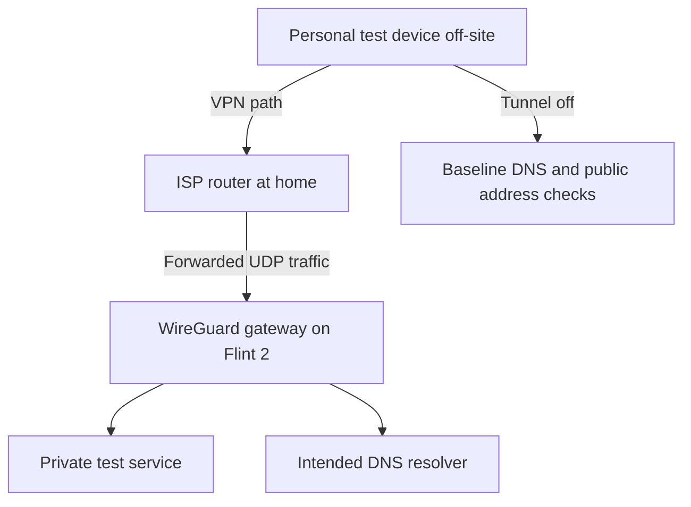

# WireGuard home lab
Malachi Pride · 255 Networks

In February 2025 I investigated three questions about my home network. Was the VPN gateway reachable from outside the house? Did DNS follow the intended path? Would a separate exit-node test change the public address seen by a Mac? These questions require different evidence. I had help with the original installation. My contribution was configuring the home edge, investigating the observed behaviour and documenting how to verify it.

## Lab topology

This diagram represents the roles in the lab. The two branches after the gateway show separate tests. The comparison path provides a baseline for each.

## What the troubleshooting notes establish

| Date | Recorded observation | Question left open |
| --- | --- | --- |
| 2 February 2025 | I ran a DNS check with the tunnel active. The result raised a question about which resolver handled the request. | No paired baseline and resolver-side record was retained. The DNS path is unconfirmed. |
| 7 February 2025 | I reported using WireGuard on a Flint 2 (GL-MT6000). In a separate Tailscale exit-node comparison on a Mac, the expected public-address change was absent. | The comparison did not establish a cause or the state of the WireGuard path. |
| 14 February 2025 | I reported setting a static WAN address for the gateway behind the ISP router and applying a UDP forwarding rule. The firewall loaded with warnings. | A successful off-network handshake and private-service response were still unverified. |

A loaded firewall configuration records a local change. To establish remote access, I would pair a fresh handshake on the home gateway with a successful request to a private test service from an independent connection. The [validation plan](validation-plan.md) specifies the controls and the evidence for each result. The [observation register](observations.csv) makes the dated record and its limits easy to inspect.

## References

[WireGuard project](https://www.wireguard.com/) · [Official quick start and peer status](https://www.wireguard.com/quickstart/)
